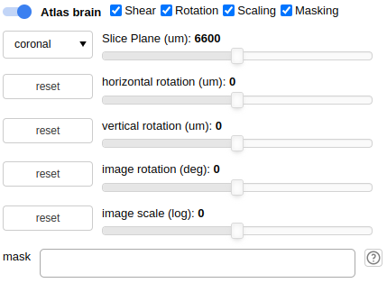
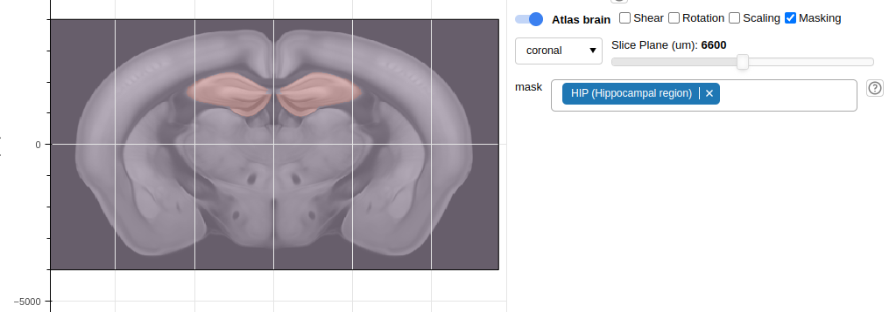

.. _atlas:

Atlas Mouse Brain
=================

Requires optional dependency `brainglobe-atlasapi`_.

.. _brainglobe-atlasapi: https://github.com/brainglobe/brainglobe-atlasapi

Install
-------

::

    pip install brainglobe-atlasapi

Command-line Options
--------------------

Use ``--atlas`` to specify which atlas to use.
You can use ``brainglobe_atlasapi.show_atlases()`` to show all available atlases.
For mouse brain atlases, you can use ``--atlas=25`` to select the ``allen_mouse_25um`` atlas.

On the **first** run, NeuroCarto needs time to download the corresponding atlas.

By default, the atlas view is shown once the corresponding package is installed.
If it is not shown, use ``--view=atlas`` on the command line.

Application View
----------------

Once ``brainglobe-atlasapi`` is installed, a brain slice is shown in the middle figure.

Controls
~~~~~~~~

*   Moving

    On the figure toolbar |figure-toolbar|, select |bk-tool-icon-box-edit|.

    Use the mouse cursor to drag the image.
    A boundary around the image follows your movement.
    Once you release the mouse button, the atlas image will update to the new position.

*   Other controls

    |atlas-controls|

    *   Slice view: change between ``coronal``, ``sagittal``, and ``transverse``.
    *   Slice plane: change the slice plane.
    *   Shear: change the horizontal or vertical plane difference.
    *   Rotation: rotate the image. The content of the image is rotated instead of the image itself due to a technical limitation.
    *   Scaling: scale the image.
    *   Masking: add a colored shadow on the corresponding regions.

        |atlas-mask|

Configurations
--------------

It is saved in the configuration file beside the corresponding channelmap file. It looks like this::

    {
      "AtlasBrainView": {
        "atlas_brain": "allen_mouse_25um",
        "brain_slice": "coronal",
        "slice_plane": 264,
        "slice_rot_w": 0,
        "slice_rot_h": 0,
        "image_dx": 0.0,
        "image_dy": 0.0,
        "image_sx": 1.0,
        "image_sy": 1.0,
        "image_rt": 0.0
      }
    }
