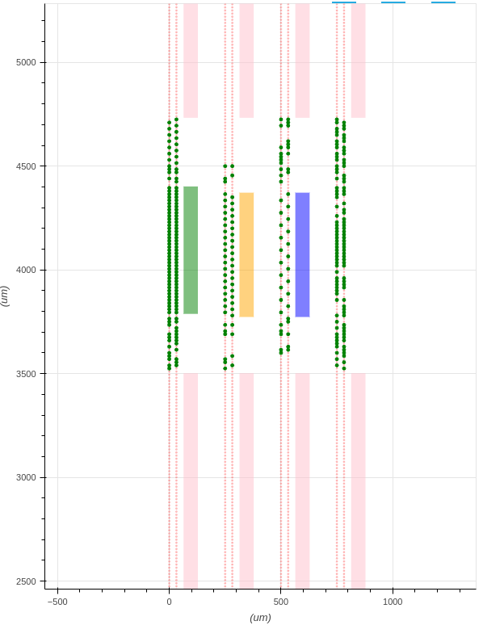

Blueprint View
==============

Shows the blueprint beside the probe.

Electrode Category value colors:

* green: pre-selected, full-density
* orange: half-density
* blue: quarter-density
* transparent: low-density, unset
* pink: excluded

Command-line Options
--------------------

It is enabled by default.
If it is not shown, use ``--view=blueprint`` on the command line.
