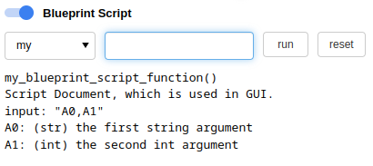

Blueprint Script View
=====================

**This is an experimental feature.** Run custom scripts.

Command-line Options
--------------------

Use ``--view=script`` to enable it.

Create an external script
-------------------------

See ``tests/bp_example.py``.

.. literalinclude:: _static/bp_example.py
   :language: python
   :lines: 20-32

Configurations
~~~~~~~~~~~~~~

It uses the user config. To add the example above::

    {
      "BlueprintScriptView": {
        "actions": {
          "my": "tests:bp_example:my_blueprint_script_function"
        }
      }
    }

Run an external script
~~~~~~~~~~~~~~~~~~~~~~

With the config above, you have an action named ``my`` that runs the function ``my_blueprint_script_function``.

