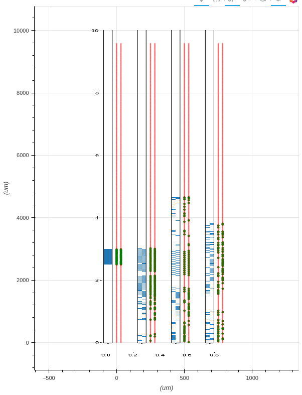

Matplotlib Image View
=====================

**This is an advanced feature.** Show dynamically generated images (via ``matplotlib``) as a background image.

Command-line Options
--------------------

It does not have a standard command-line option.

How to create a view
---------------------

It has a testing option for demonstration purposes::

    --view=test:main_image_plt_plot_channelmap:PlotChannelMap

See ``tests/main_image_plt_plot_channelmap.py``.

.. literalinclude:: _static/main_image_plt_plot_channelmap.py
   :language: python
   :lines: 7-34

Run the file directly and load a channelmap file. ::

    python tests/main_image_plt_plot_channelmap.py

