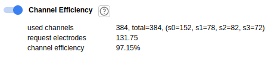

Neuropixels Statistics View
===========================

**This is a Neuropixels probe-specific feature.**
Calculates values for a channelmap and a blueprint.

* **used channels**: contains

  * current channel (selected electrode) count
  * total channel count
  * number of channels per shank.

* **request electrodes**: The requested electrode count for pre-selected, full-density, half-density,
  and quarter-density areas.

* **channel efficiency**: The efficiency of channel usage. It can also be used to determine whether
  a blueprint is compatible.
