Getting Started
===============

Run NeuroCarto. ::

    neurocarto

Then your default web browser will open the application at http://localhost:5006/.

:warning:
    The application is tested in Google Chrome.


Command-line Options
--------------------

::

    usage: neurocarto [-h] [-C PATH] [-P NAME] [--selector MODULE:NAME] [--atlas NAME]
                      [--atlas-root PATH] [--config-file FILE] [--view MODULE:NAME]
                      [--server-address URL] [--server-port PORT] [--no-open-browser]
                      [FILE]

    positional arguments:
      FILE                  open a channelmap file.

    options:
      -h, --help            show this help message and exit

    Source:
      -C PATH, --chmap-dir PATH
                            channelmap saving directory

    Probe:
      -P NAME, --probe NAME
                            use a probe family. default is "npx" (Neuropixels probe family).
      --selector MODULE:NAME
                            use the specified electrode selection method

    Atlas:
      --atlas NAME          atlas mouse brain name
      --atlas-root PATH     atlas mouse brain download path

    Bokeh Application:
      --config-file FILE    global config file.
      --view MODULE:NAME    install extra views in the right panel
      --server-address URL
      --server-port PORT
      --no-open-browser     do not open browser when server starts

Application View
----------------

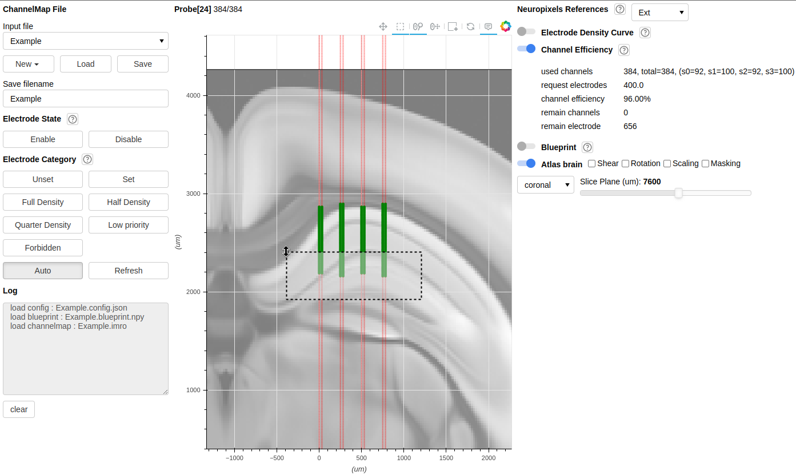

Left panel
~~~~~~~~~~

+--------------+------------------------------------------------------------------------+
| |fig4a-left| | **ChannelMap File**                                                    |
|              |                                                                        |
|              | Input file                                                             |
|              |     Channelmap files listed under ``-C PATH``.                         |
|              |                                                                        |
|              | * New : Create a new channelmap from supported probe types.            |
|              | * Load : Load a channelmap file from the *Input file* field.           |
|              | * Save: Save current channelmap file.                                  |
|              |                                                                        |
|              | Save filename                                                          |
|              |    The filename for the saved channelmap file.                         |
|              +------------------------------------------------------------------------+
|              | **Electrode State**                                                    |
|              |                                                                        |
|              | Select/Unselect electrodes captured by |bk-tool-icon-box-select|.      |
|              +------------------------------------------------------------------------+
|              | **Electrode Category**                                                 |
|              |                                                                        |
|              | Set the electrode category for electrodes captured                     |
|              | by |bk-tool-icon-box-select|.                                          |
|              +------------------------------------------------------------------------+
|              | **Log**                                                                |
|              |                                                                        |
|              | Application logging messages.                                          |
+--------------+------------------------------------------------------------------------+

Top Panels
~~~~~~~~~~

|probe-desp| ``Probe[CODE] CURRENT/TOTAL``.

CODE
  Current probe code.
TOTAL
  Total number of channels.
CURRENT
  Number of electrodes selected as channels.

|figure-toolbar|

Bokeh provides these figure tools:

* |bk-tool-icon-pan| (mouse drag): move the figure view.
* |bk-tool-icon-box-select| (mouse drag): select electrodes for
  setting their state and category.
* |bk-tool-icon-wheel-zoom| (mouse wheel): zoom the figure view.
* |bk-tool-icon-wheel-pan| (mouse wheel): move the viewport vertically.
* |bk-tool-icon-box-edit|: move the background image.
  (shifted-drag) move/scale image inside the dragged rectangle.
* |bk-tool-icon-reset|: reset the figure view.
* |bk-tool-icon-hover|: display electrode information when mouse
  moves on electrodes.
* |bk-logo-small|: Bokeh logo. Click it to go to the Bokeh website.

Figure Panel
~~~~~~~~~~~~

electrodes
``````````

|custom-chmap|

Electrode colors indicate:

* black : selectable electrodes
* green: selected electrodes
* red: un-selectable (disabled) electrodes
* yellow: highlighted electrodes related to electrodes captured by |bk-tool-icon-box-select|.

Background Image
````````````````

Atlas mouse image. This requires an extra package. See :ref:`atlas`.

Right Panel
~~~~~~~~~~~

|fig4a-right|

All components share a common layout structure:

::

    +-----------------+-------+-------+-----------+--------+
    | visible_switch? | title | help? | controls? | status |
    +-----------------+-------+-------+-----------+--------+
    | custom contents                                      |
    +------------------------------------------------------+

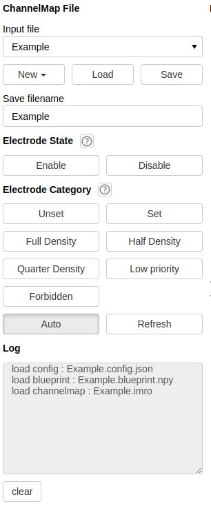
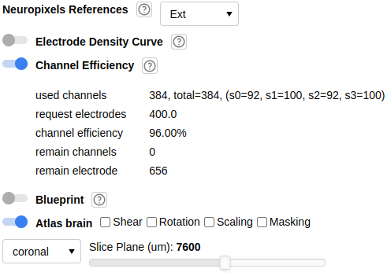
.. |figure-toolbar| image:: _static/figure-toolbar.png


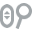
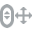
.. |bk-tool-icon-box-edit| image:: _static/bk-tool-icon-box-edit.png


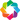

Build your first channelmap
---------------------------

A simple channelmap
~~~~~~~~~~~~~~~~~~~

1.  Press **New** and choose a probe type to create/reset an empty channelmap.

    |new-probe|

2.  Move the probe (shown as electrodes) to the proper place.
3.  Use rectangle-tool in the figure toolbar to select electrodes.

    |rect-select-tool|

    Selected electrodes will be kept in black and highlighted in yellow, and other electrodes will be faded.

    Other electrodes are also highlighted in yellow, which indicates that they cannot be selected,
    according to Neuropixels' hardware restriction.

    |rect-select-electrodes|

4.  Click **Enable** to set the captured electrodes as readout channels.

    |enable-electrodes|

    The yellow highlighted electrodes, except the captured ones, will disappear.
    However, they are still selectable and will overwrite the previous ones when they are enabled.

    before: |rect-select-electrodes-overwrite| after: |rect-select-electrodes-after|

5.  Repeat picking until text becomes |probe-desp| at the top of the figure.
6.  Type the new filename for your channelmap in **Save filename** field.

    |save-map|

7.  Press **Save**.

    You will see messages in **Log** saying that the files were saved.

    |save-log|

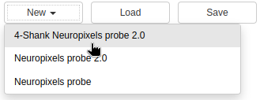
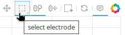
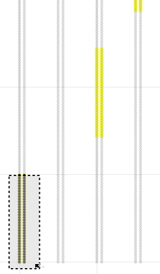
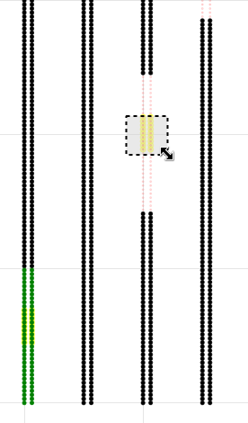
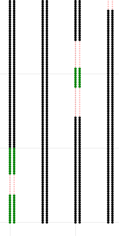
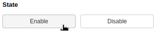
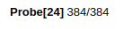
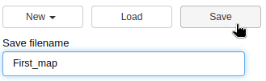
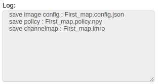

Saved Files
~~~~~~~~~~~

Once you save a channelmap (use previous example), then you will get files under ``-C PATH``:

* ``First_map.imro``: channelmap file
* ``First_map.blueprint.npy``: electrode blueprint matrix
* ``First_map.config.json``: view configurations for each component, such as the coordinates of the atlas mouse image.

Once ``First_map.imro`` is loaded, the other files are also loaded to restore the saved state.

A custom channelmap
~~~~~~~~~~~~~~~~~~~

1.  Press **New** and choose a probe type to create/reset an empty channelmap.
2.  (optional) Move and adjust the atlas image to the proper view for your experimental goal.

    For example, I want to record signals from the Hippocampus.

    1.  Change **Slice view** to *coronal*. |atlas-slice|
    2.  Move **Slice Plane** to *290*.
    3.  Adjust other settings if needed.
    4.  Use box-edit in the figure toolbar to move the atlas image
        to the proper position so that the probe passes through the Hippocampus.

        |box-edit-tool-hinted|

3.  Move the probe (shown as electrodes) to the proper place.

    |atlas-image-probe|

4.  Use rectangle-tool |bk-tool-icon-box-select| in the figure toolbar to select electrodes in a particular area,
    then press one of the buttons in **Electrode Category**.

    |policy-full-density|

    In this step, rather than directly selecting electrodes as readout channels, we set categories on captured electrodes.
    These category settings build a blueprint for all electrodes, and the application generates a channelmap
    that follows the given blueprint.

    There are recommended steps for building a blueprint.

    1.  Set electrodes outside the brain with **Excluded** category, so forbidden electrodes are never selected.

        Select |electrodes-outside| and set |excluded|.

    2.  Set electrodes around the regions of interest (Hippocampus structure here) with **Set** or **Full Density** category.

        |roi|

    3.  Set the other electrodes with a category.
    4.  A valid channelmap will be updated automatically |auto|.

5.  Check that the text becomes |probe-desp| at the top of the figure.

    |custom-chmap|

    If not, the current blueprint is not compatible with the Neuropixels hardware restrictions. See `Tips on building custom channelmap`_.

6.  Type the new filename for your channelmap in **Save filename** field.
7.  Press **Save**.

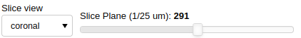
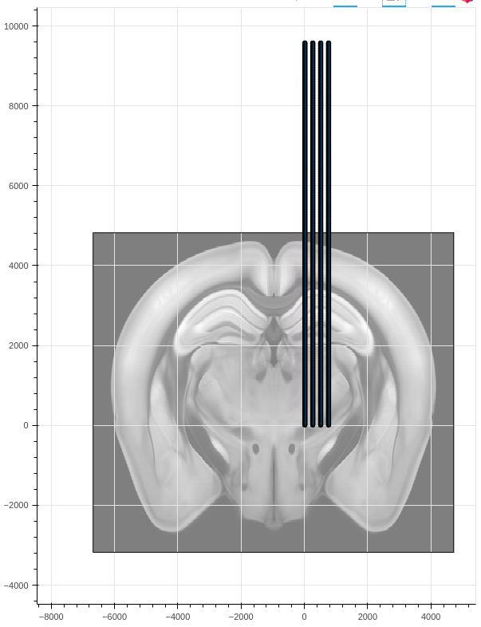
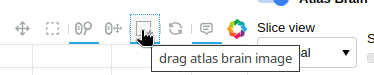
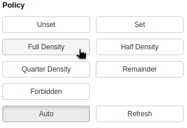
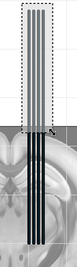
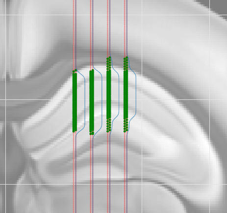
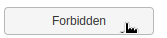
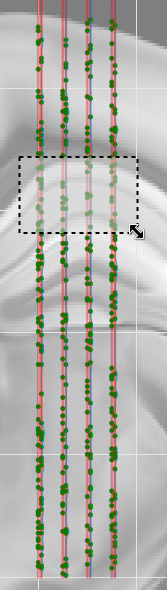
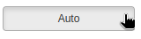


Tips on building custom channelmap
~~~~~~~~~~~~~~~~~~~~~~~~~~~~~~~~~~

TODO
